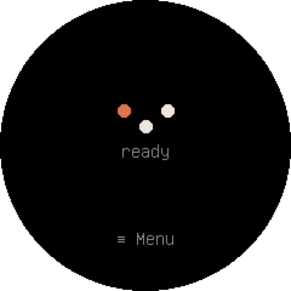
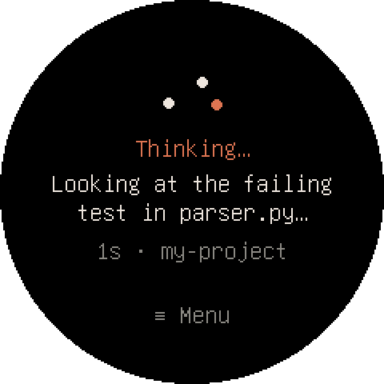
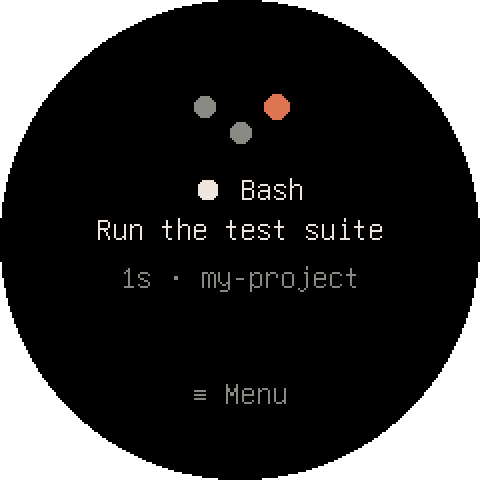
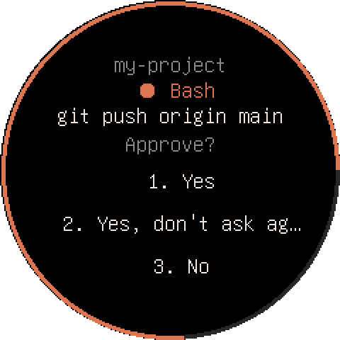
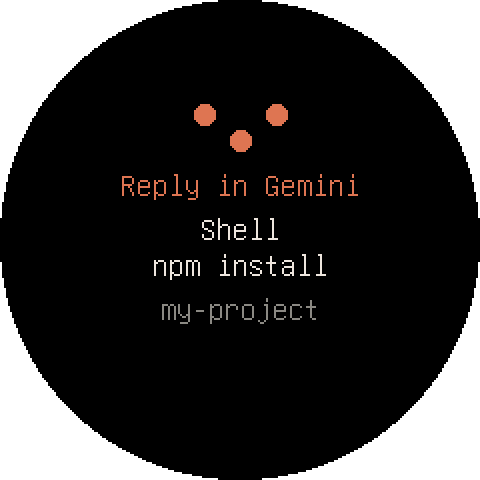
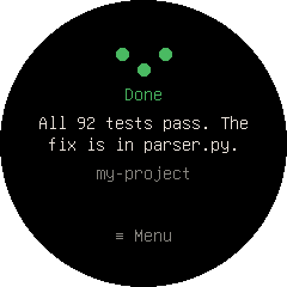

# Tredot

Tredot is a small round touch screen that sits next to your keyboard and shows what your AI coding
agent is doing. When Claude Code wants to run a command or edit a file, the request appears on the
screen and you approve or deny it with a tap. The module also has a microphone and a camera, so you
can record voice notes, take photos and videos, and talk to Claude without touching the computer. A
macOS menu-bar app connects the module to the Mac over USB, Wi-Fi or Bluetooth, encrypted after a
one-time pairing.

- **Status at a glance:** thinking, running a tool, waiting for you, done. Each Claude Code session
  is tracked separately.
- **Approve with a tap:** Claude Code permission prompts appear on the module. Any MCP agent can ask
  for approval through the `approve` tool.
- **Voice notes:** transcribed on the Mac with Whisper, summarized into a Markdown note.
- **Photos and video:** saved on the Mac. Agents can ask you to take a photo and then look at it.
- **Talk to Claude:** speak to an agent and read the answer on the screen.
- **Works with** Claude Code (plugin with hooks and MCP tools), Claude Desktop (extension) and
  Gemini CLI (MCP tools and status hooks). Other MCP clients should work but are untested.

| | | |
|:---:|:---:|:---:|
|  |  |  |
| Ready | Thinking | Running a tool |
|  |  |  |
| Approve with a tap | Gemini CLI asks in its terminal | Done |

*Real screenshots of the module's screen (menu-bar app → **Take a Screenshot of the Module**).*

How it works: [docs/ARCHITECTURE.md](docs/ARCHITECTURE.md). Releasing:
[docs/RELEASING.md](docs/RELEASING.md). What's next: [docs/ROADMAP.md](docs/ROADMAP.md).

## Hardware

- **Seeed Studio XIAO ESP32-S3 Sense**, the board with the camera and microphone daughterboard
- **Seeed Studio Round Display for XIAO**, with the XIAO plugged into the back
- The **U.FL antenna** that comes with the XIAO, attached. Wi-Fi and Bluetooth are unusable without it.
- A USB-C cable (for power, pairing and the first firmware flash)

- On the back of the Round Display (version 1.1 or later), the small **2-position switch** marked
  "ON KE": **switch 2 must be on** the ON side. It connects the XIAO's D6 pin to the screen's
  backlight. With it off the backlight is always lit and the screen can't turn off. In our module
  switch 2 is on the ON side. Switch 1 (battery reading) can stay as it is. Don't confuse it with
  the larger OFF/ON power slider.

The module uses 2.4 GHz Wi-Fi only. A network that has 2.4 and 5 GHz under the same name works.

"XIAO" is a trademark of Seeed Technology, "Claude" of Anthropic and "Gemini" of Google. Tredot is
an independent project that works with Claude Code, Claude Desktop and Gemini CLI. It is not
affiliated with or endorsed by any of them.

## Install

You need a Mac with Apple Silicon running macOS 13 or later, plus Claude Code, Claude Desktop or
Gemini CLI.

1. Download `Tredot <version>.dmg` from
   [GitHub Releases](https://github.com/bazrafkan/tredot/releases/latest), open it and drag
   **Tredot** into **Applications**.
2. Open Tredot. The app is not notarized by Apple yet, so the first time macOS refuses to open it.
   Go to **System Settings > Privacy & Security**, click **Open Anyway** next to the message about
   Tredot, and confirm.
3. Three dots in an arc appear in the menu bar. If you can't see them, the menu bar is full and
   macOS is hiding icons behind the notch.

macOS asks for these permissions as you use the app:

| Permission | Why |
|---|---|
| Bluetooth | to reach the module without a cable |
| Local Network | to find and reach the module on your Wi-Fi |
| Speech Recognition | only until the Whisper model has downloaded (see below). Recognition runs on the Mac. |

The app doesn't need microphone or camera access because both are on the module.

On first launch the app downloads the Whisper speech model (574 MB) from Hugging Face and shows the
progress in the menu. It checks the file's SHA-256 before using it. Until the download finishes,
voice notes are transcribed with macOS on-device speech recognition.

The `.dmg` doesn't flash a blank board. A new module needs its first firmware written over USB (see
[Build from source](#build-from-source)). After that, firmware updates come from the app.

## First use

1. **Pair.** Connect the module with the USB cable and choose **Pair This Mac…** from the menu. The
   module asks whether to pair. Tap **Yes**, then tap it again to confirm. Pairing only works over
   the cable. After that, every link is encrypted and Bluetooth turns on.
2. **Wi-Fi.** Choose **Connect to Wi-Fi…** and enter the network name and password. They go to the
   module encrypted, and the password isn't stored on the Mac. If the module can't join, the menu
   says why (wrong password, network not found, rejected by the router).
3. **Agents.** In the menu, choose:
   - **Connect to Claude Code** to install the `tredot` plugin. New sessions get the status screen,
     tap approvals and the MCP tools. Restart any sessions that are already open.
   - **Install in Claude Desktop…** to open the `tredot.mcpb` extension in Claude Desktop. Confirm
     with **Install**. New chats get the MCP tools.
   - **Connect to Gemini CLI** to add the MCP server and status hooks to `~/.gemini/settings.json`.
     In our tests Gemini CLI needed an API key (`GEMINI_API_KEY`) rather than a personal Google
     login.

Once paired, the cable is only needed for power. The bridge picks the best link on its own (Wi-Fi,
then USB, then Bluetooth), so unplugging the cable interrupts nothing.

The menu-bar icon shows the connection: all three dots filled means connected and encrypted, only
the first filled means connected but not paired, and empty dots mean not connected. The arc spins
while an action is running.

### Other MCP clients (untested)

The MCP server is `~/Library/Application Support/Tredot/marketplace/plugin/scripts/mcp_server.py`.
Run it with `~/Library/Application Support/Tredot/python3`, a link to the app's Python that the app
refreshes on every launch. Connect Claude Code or Gemini CLI from the menu first, because that step
writes the marketplace folder. Use full paths instead of `~`.

- Cursor, in `~/.cursor/mcp.json`: `{"mcpServers": {"tredot": {"command": "<python3>", "args": ["<mcp_server.py>"]}}}`
- Codex CLI, in `~/.codex/config.toml`: a `[mcp_servers.tredot]` table with the same `command` and `args`
- VS Code: `code --add-mcp '{"name": "tredot", "command": "<python3>", "args": ["<mcp_server.py>"]}'`

## On the module

| Screen | Meaning |
|---|---|
| Three still dots, "ready" | idle |
| Dots wandering, "Thinking…" | the agent is working |
| Dots lighting up in turn, tool name and description | the agent is running a tool, for example `Bash` and what the command does |
| Orange dots blinking, "Reply in Claude" | the agent is waiting for you at the computer ("Reply in Gemini" for Gemini CLI) |
| Green dots, "Done", start of the reply | the turn is finished. Tap to dismiss. |
| Red dots | an error, such as a Claude API error or a voice note that failed |
| Screen completely dark | asleep (see below) |

**Sleep.** After 30 seconds with no news from the agent and no touch, the screen and its backlight
turn off. They turn on again with the next message from the agent (thinking, a tool, done, a request)
or with a touch. That first touch only wakes the screen: it doesn't tap anything. The screen never
sleeps while a request waits for your answer, while recording or with the camera on.

**Approving.** When Claude Code asks for permission, the module shows the tool and the exact action,
with choices such as **Yes**, **Yes, always: …**, **No** and **In Claude**. Tap a choice once to
select it and again to confirm, so a stray touch can't approve a `git push`. **No** stops Claude as
the dialog's No would. If you don't answer within 60 seconds, or you choose **In Claude**, the usual
dialog appears on the Mac. When several sessions are open, the module shows the one with the most
recent event.

**Menu.** Tap **≡ Menu** at the bottom of the screen:

- **Talk to Claude:** speak, then tap to stop. Claude answers on the screen, one page per tap.
- **Voice note:** speak, then tap to stop. The Mac transcribes the recording, writes a note
  (title, summary, key points, to-dos, transcript) and keeps the `.wav` next to it.
- **Photo:** the viewfinder appears. Tap to shoot.
- **Video:** tap to stop (10 minutes at most). Not available over Bluetooth.

Notes, photos and videos go to folders under `~/Documents/Tredot/`. **Open Notes** in the menu
takes you to the notes. **Open Knowledge Graph** opens a page that draws your notes and the
people, projects and topics they mention (Claude lists them in each new note; the first time it also
does it for the old ones); two notes that share one are linked. It updates after every note. **Take a Screenshot of the Module** saves what the screen shows as a round
PNG in the media folder and opens it. To use other folders, see [Configuration](#configuration).

**Talk to Claude** goes to a built-in agent (Claude Agent SDK, signed in with your Claude Code login).
It can use the module's tools and keeps one conversation per day, with a diary in the notes folder.
If you start a terminal session with `./talk.sh [folder]` (development channel, research preview),
your voice goes into that Claude Code session instead.

**MCP tools** available to every connected agent:

| Tool | What it does |
|---|---|
| `approve` | asks you to approve an action before the agent does it. Returns `approved`, `denied` or `no answer` after 2 minutes. |
| `ask` | a question with 2 to 4 answers to tap |
| `show` | a short message on the screen |
| `listen` | asks a question and returns your spoken answer, transcribed |
| `photo` | asks you to frame something and returns the photo |
| `status` | firmware version, link and encryption |

## Updates

- **The app:** choose **Check for Updates…** in the menu. The app also checks once a day. It
  installs an update only if it carries our EdDSA signature, then restarts.
- **The module's firmware:** each app version bundles the latest firmware. When it differs from the
  module's firmware, the menu offers **Update Firmware to <version>**. The update runs over USB or
  Wi-Fi (never Bluetooth). At the end the module asks you to confirm on screen. If anything fails
  before you tap **Yes**, the module keeps its current firmware. If the new firmware crashes before
  it reconnects to the Mac, the module rolls back on its own.

Until the app is signed with an Apple Developer ID, macOS asks again for Bluetooth, Local Network and
Speech Recognition after each update.

## Privacy and security

- **Voice stays on the Mac.** Whisper and the macOS fallback both run locally. Audio is never
  uploaded.
- **Your own Claude does the summaries.** Voice-note summaries and Talk to Claude go to Claude
  through your own Claude Code installation and account, the same as typing to Claude.
- **Encrypted link.** After pairing over the cable, every line between the Mac and the module is
  encrypted and authenticated with AES-256-GCM, using per-session keys and counters that reject
  replays. An approval only counts if it arrives encrypted with the pairing key.
- **No server of ours.** Tredot has no account, no analytics and no backend. The only network calls
  it makes on its own are the update check (GitHub Releases) and the one-time model download
  (Hugging Face).
- Wi-Fi credentials are sent to the module encrypted and stored only on the module. The pairing key
  is in `~/.config/tredot/pairings.json`, readable only by your user.

## Build from source

Requirements:

- [Homebrew](https://brew.sh)
- The Xcode command-line tools (`xcode-select --install`)
- [Claude Code](https://docs.claude.com/claude-code)
- For the firmware: `arduino-cli` with the ESP32 core (`esp32:esp32` 3.3.x) and the libraries
  *GFX Library for Arduino*, *U8g2* and *JPEGDEC*

```bash
./install.sh
```

The script installs what's missing (`uv`, `cmake`), creates the Python environment in `mac/.venv`,
creates `~/.config/tredot/config.json`, builds `Tredot.app` (compiling Whisper the first time) and
connects Claude Code and Gemini CLI. You can run it again: it only redoes what's missing. To uninstall
the app and the agent connections, run `./install.sh remove`. Configuration, notes and media stay.

Firmware:

```bash
./firmware.sh          # compile into build/
./firmware.sh flash    # compile and write over USB with esptool: first flash, or a module that no longer boots
./firmware.sh update   # compile and update through the bridge, over USB or Wi-Fi (module must be paired)
```

`flash` stops the bridge while it writes. It doesn't erase the settings partition, so pairing and
Wi-Fi survive.

App and packages (run from `mac/`):

```bash
.venv/bin/python build_app.py      # rebuild Tredot.app in place after changing mac/ or the firmware
.venv/bin/python build_dmg.py      # build/Tredot <version>.dmg
.venv/bin/python build_plugin.py   # regenerate plugin/ after changing hook.py, mcp_server.py, module.py or config.py
```

`build_app.py` bundles the last firmware compiled into `build/`, so run `./firmware.sh` first.

Tests:

```bash
cd mac && .venv/bin/python -m unittest discover -s tests
```

The tests run a real bridge against a fake module (a pseudo serial port) in a temporary folder. They
don't touch the running bridge or a real module.

The terminal equivalents of the menu items are `mac/pair.py` (`pair`, `status`, `unpair`),
`mac/wifi.py` and `mac/update_firmware.py`. Run them with `mac/.venv/bin/python`.

## Languages

Tredot speaks English and Italian, following the Mac's language: the menu-bar app (through macOS
localization), the texts the Mac sends to the module, and the module's own screen (the Mac tells the
module its language when it connects; the module remembers it). Voice notes and answers from Claude
follow the language you speak. To force a language, set `ui_language` in the configuration.

Adding a language: a table in `mac/i18n.py`, a `Localizable.strings` and `InfoPlist.strings` in
`mac/app/<lang>.lproj/` (and `CFBundleLocalizations` in `mac/build_app.py`), and a column in the
firmware's text table.

## Configuration

Settings live in `~/.config/tredot/config.json`, or in the file named by `TREDOT_CONFIG`. A missing
key takes its default from `mac/config.py`. To print the effective configuration, run
`mac/.venv/bin/python mac/config.py`.

| Key | Meaning |
|---|---|
| `notes_dir`, `media_dir` | where voice notes, photos and videos go |
| `ui_language` | language of the app, the module's screen and the voice-note headings: `auto` (default: the Mac's language), `en` or `it` |
| `language` | the language you speak, for transcription (`it`, `en`, `fr`, …). The default `auto` uses the Tredot language: set it if you speak another one. |
| `vocabulary` | names Whisper tends to get wrong, passed as context |
| `ask_timeout` | seconds to answer on the module before the request goes back to the agent's window (default 60) |
| `link` | `auto` (default), `usb`, `wifi` or `ble` |
| `agent.model`, `agent.cwd`, `agent.prompt` | model, working folder and personal instructions for Talk to Claude |

## Troubleshooting

Logs are in `~/.cache/tredot/` (**Open Logs** in the menu). Start with `bridge.log`. The first lines
of the menu show the module, its firmware, the active link and the module's Wi-Fi state. To log
every agent event to `events.log`, set `TREDOT_DEBUG=1` or create the file `~/.cache/tredot/debug`.

## Repository layout

```
firmware/tredot/     ESP32-S3 firmware (Arduino): tredot.ino plus links, BLE, Wi-Fi, security, OTA
mac/                 the Mac side in Python: bridge, hooks, MCP server, voice notes, agent, build scripts
mac/app/             Swift sources: the menu-bar app, video muxer, speech fallback, icon
mac/tests/           unit and integration tests (fake module)
plugin/              Claude Code plugin, generated by mac/build_plugin.py
.claude-plugin/      marketplace that serves plugin/ from this repository
tools/ctags          empty stub: Arduino's ctags only exists for Intel Macs
docs/                architecture, releasing, roadmap
LICENSE              MIT
firmware.sh          compile, flash or update the firmware
install.sh           development setup
talk.sh              Claude Code session that receives "Talk to Claude"
```

## License

Tredot is released under the [MIT License](LICENSE).

It builds on third-party software, each under its own license:

| Component | Used for | License |
|---|---|---|
| [whisper.cpp](https://github.com/ggml-org/whisper.cpp) and the large-v3-turbo model | voice transcription (bundled in the app; the model is downloaded on first launch) | MIT |
| [Sparkle](https://sparkle-project.org) | app updates | MIT |
| [python-build-standalone](https://github.com/astral-sh/python-build-standalone) | the Python runtime inside the app | Python Software Foundation License and others |
| Python packages in `mac/uv.lock` (bleak, cryptography, zeroconf, numpy, pyserial, claude-agent-sdk, …) | the bridge | their own licenses (MIT, BSD, Apache 2.0) |
| [Arduino core for ESP32](https://github.com/espressif/arduino-esp32) | firmware | LGPL 2.1 |
| [GFX Library for Arduino](https://github.com/moononournation/Arduino_GFX), [U8g2](https://github.com/olikraus/u8g2), [JPEGDEC](https://github.com/bitbank2/JPEGDEC) | screen, fonts, viewfinder | BSD, BSD 2-Clause, Apache 2.0 |
